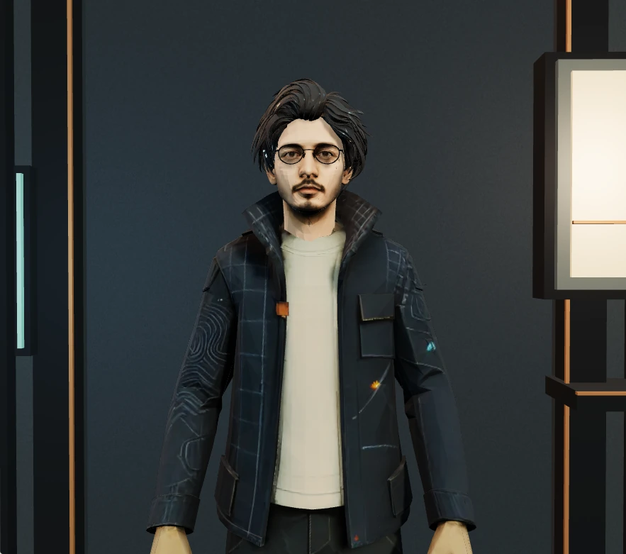

# Sadeq's Interactive 3D Digital Twin

A browser-based digital twin that combines authored character animation, continuous gesture blending, speech-driven lip movement, controlled AI context, microphone input, and resilient web fallbacks.



The visual system uses a paper-cut-inspired character treatment rather than a generic glossy avatar: layered fiber texture, an architectural studio, dimensional shadows, and controlled aqua-and-amber lighting connect it to the wider portfolio identity.

[Open the assistant](https://rammeshgar.github.io/digital-twin-demo/) · [Read the Digital Twin case study](https://rammeshgar.github.io/digital-twin/) · [Portfolio](https://rammeshgar.github.io/)

## Why this project exists

Most portfolio chatbots are detached widgets. This project explores a more coherent interface: the character's body performance, mouth movement, voice, camera and conversation state respond as one system.

The goal is not to simulate a human. It is to make a technical portfolio easier to explore while keeping the information grounded in a maintained professional profile.

## Studio experience

The second-generation interface puts the conversation and character in one workspace. The character and approved paper-cut identity are unchanged; the presentation uses a more deliberate architectural set, portrait framing and a restrained copper-and-aqua lighting palette.

The portfolio's [Digital Twin case study](https://rammeshgar.github.io/digital-twin/) is the single technical presentation, with its system map, animated explanation, design and limitations. This repository's [standalone assistant](https://rammeshgar.github.io/digital-twin-demo/) remains a direct, shareable app. Old case-study anchors forward to the matching portfolio sections, and the original explainer files remain accessible for existing links.

The same assistant also opens directly from the portfolio homepage and technical case study, as an on-demand same-origin frame (`?embed=assistant`). The host mounts the frame only after a user activates the launcher; it renders just the studio panel, inherits the portfolio theme, and does not record a second pageview. Closing it stops speech, microphone capture and the renderer before the host removes the frame. Text remains available if 3D rendering or voice fails. The standalone app still has its own launch control.

Interface sounds are separate from the AI voice and are off by default. The 3D experience still loads only on request, and the text conversation remains available independently of rendering or speech.

## System capabilities

- Authored idle, greeting, start and explanation animations
- Dedicated transition clips for continuous gesture blending
- Three non-repeating speaking silhouettes
- Eight facial viseme targets
- Audio-energy and transcript-timing lip movement
- Text, browser speech recognition and recorded-audio transcription paths
- Controlled AI context built from a professional source of truth
- WebGL, microphone, transcription and audio fallbacks
- Responsive rendering and reduced-motion support

## Architecture

```text
Text / microphone
        |
        v
Browser recognition ---- recorded-audio transcription fallback
        |                               |
        +---------------+---------------+
                        v
             controlled AI context
                        |
                        v
                generated response
                  /             \
                 v               v
          speech playback     chat transcript
                 |
                 v
      audio analysis + transcript timing
                 |
        +--------+---------+
        v                  v
 facial visemes      blended body gestures
```

## Animation state model

```text
Idle
  |
  +-- first greeting --> Hi --> Start --> Explain 1 --> Explain 2
  |
  +-- later response --> randomized non-repeating transition cycle
                         Start <--> Explain 1 <--> Explain 2
  |
  +-- speech ends ----> Idle
```

The runtime does not jump directly between unrelated poses. Exported transition clips bridge every speaking-state combination, while Three.js cross-fades between active actions.

## Technology

- Three.js and WebGL
- GLTF/GLB skeletal animation and morph targets
- Web Speech API
- MediaRecorder API
- Google Gemini for chat and recorded-audio transcription, with optional ElevenLabs speech and browser speech fallback
- Netlify Functions
- Vanilla JavaScript, HTML and CSS

## Run locally

The model and JavaScript modules require an HTTP server; opening `index.html` directly will not work reliably.

```bash
npm run preview
```

Then open the local URL shown in the terminal. This dependency-free preview serves the same `/digital-twin-demo/` path as GitHub Pages, with analytics omitted. It does not replace the deployed AI service or make requests to it until a conversation is requested.

For a mock-only browser check of the standalone routes, embedded handshake, phone and desktop layout, theme, and cleanup, run `node tools/check-embedded-studio.mjs` with Playwright installed. The script intercepts network requests and replaces microphone access, so it does not contact the AI or speech provider.

## Rebuild the optimized web model

The checked-in GLB is prepared in two stages: texture resizing through Blender, followed by lossless animation cleanup and Meshopt compression.

```bash
blender --background --python tools/prepare_web_glb.py -- source.glb prepared.glb 1024
npx @gltf-transform/cli optimize prepared.glb assets/sadeq-digital-twin.meshopt.glb --compress meshopt --meshopt-level high --flatten false --join false --palette false --simplify false --texture-compress false
```

Validate the animation names and morph targets after every rebuild before replacing the published asset.

The public assistant uses the same deployed portfolio API for chat and transcription. The shared [backend repository](https://github.com/Rammeshgar/mascot-backend) owns the production conversation service. The files bundled under `netlify/functions/` document a compatible implementation and its persona/knowledge inputs; editing a frontend repository copy alone does not update the deployed conversation service. To run your own backend, deploy your server-side functions and change the two API constants in `mascot.js`. Keep credentials off the frontend.

## Environment variables

The serverless functions require provider credentials. Keep them in the deployment platform and never commit them.

The shared backend uses `GEMINI_API_KEY` (or `GOOGLE_API_KEY`) and an optional `GEMINI_CHAT_MODEL` override; otherwise it uses `GEMINI_MODEL` or the configured default. ElevenLabs remains optional. Refer to the function source for the other environment-variable names.

## Performance decisions

- Texture preparation and Meshopt compression reduce the web GLB from 22.6 MB to approximately 4.1 MB while preserving the original paper-cut character, rig and morph targets. The runtime adds an 18-clip movement library without replacing the approved model.
- The 3D model loads only when the interactive viewer opens.
- Three.js 0.167.1 and the required loader, controls, decoder and geometry utilities are served locally, preserving the exact original library version while avoiding a third-party CDN dependency. Their MIT license is included in `vendor/three/LICENSE`.
- Portfolio typefaces are served locally. The launch preview is a compressed capture of the live 3D studio rather than separate artwork.
- Mobile rendering uses a lower pixel ratio and disables expensive shadows.
- Renderer resizing is observed instead of continuously polling layout.
- Mouth shapes are smoothed to avoid visual chatter.
- The text interface remains usable while the model loads or if WebGL fails.
- Reduced-motion preferences disable non-essential interface animation.

The GLB remains the largest asset. Further texture or geometry reduction should only ship after visual comparison confirms that it preserves the face, papercut material treatment and animation quality.

## Privacy and limitations

- Microphone recordings are used only to transcribe the current question.
- AI responses can be incorrect and should not be treated as Sadeq speaking personally.
- The assistant is restricted to a maintained professional knowledge source.
- Browser speech and microphone behavior varies by browser and permission state.

## Asset provenance

See [ASSET_NOTES.md](ASSET_NOTES.md) for the distinction between authored engineering, adapted animation assets and AI-assisted visual work.

## Author

**Sadeq Rezai** — Technology implementation & automation specialist working across software configuration, automated validation, data tools and AI-assisted workflows.

- [Engineering portfolio](https://rammeshgar.github.io)
- [LinkedIn](https://www.linkedin.com/in/sadeqrezai)
- [GitHub](https://github.com/Rammeshgar)

## License

Source code is available under the [MIT License](LICENSE). The character model and visual identity assets are excluded from that license; see [ASSET_NOTES.md](ASSET_NOTES.md).
